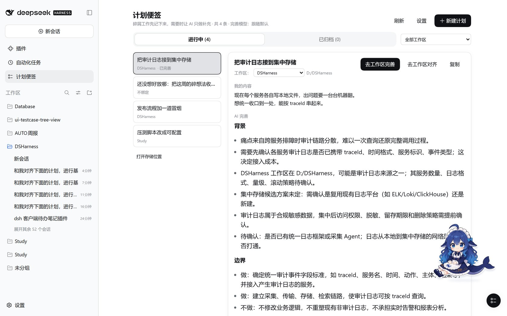
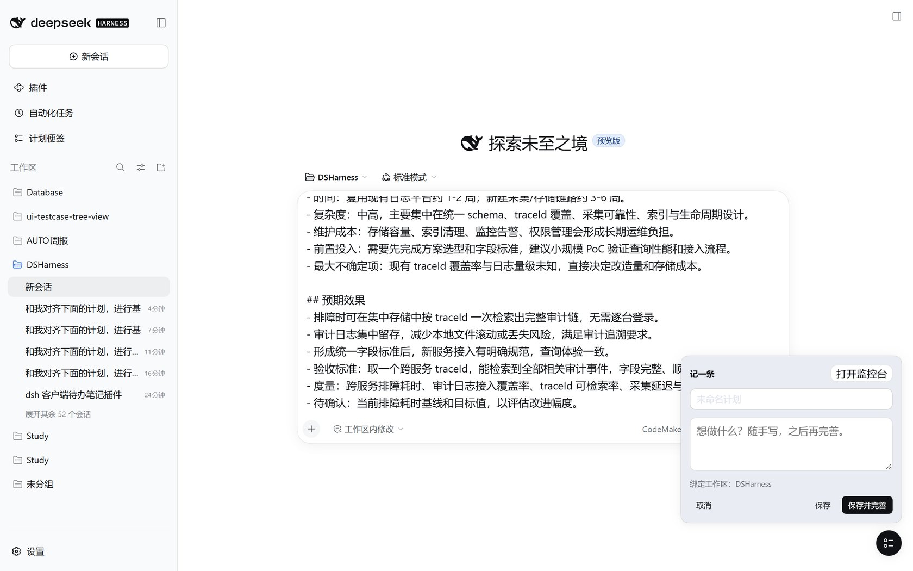
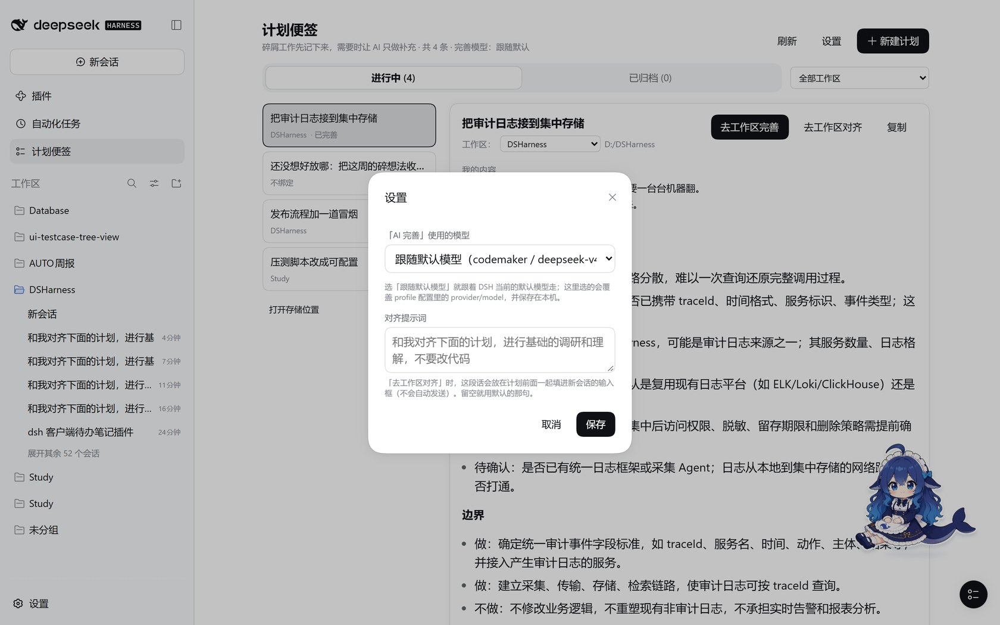
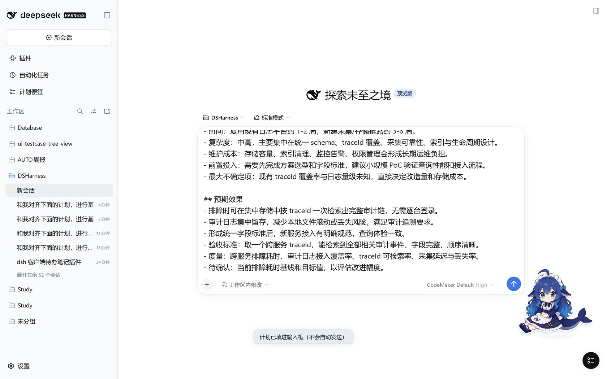

# dsh-todonote

> 碎屑工作的计划便签：随手记一条，需要时让 AI **只做补充、不执行任何动作**，想动手了再一键把它送进对应工作区的会话。

一个 DSH（DeepSeek Harness）Web 客户端插件：Host 半边负责存储和模型调用，浏览器半边负责三个界面。



## 它解决什么

碎屑工作最烦的不是做，是「记在哪里」：记在聊天里会被刷走，记在笔记软件里和代码脱节，记在 TODO 里又没有上下文。

TodoNote 的做法是：

- **你的原文永远是你自己写的**：AI 的输出存在另一个字段里，不覆盖、不删减、不「帮你优化」；
- **AI 只做补充**：拿到便签后按固定五节帮你补齐思路（背景 / 边界 / 影响面 / 成本 / 预期效果），**不写代码、不改文件、不跑命令**。这不是靠提示词约束，而是那次调用**根本没有 tools** —— 模型没有可执行的通道；
- **什么时候调用由你决定**：只有点「AI 完善」才跑模型，保存便签时不会偷偷调用；
- 想推进了，**「去工作区对齐」**把便签（连同 AI 的补充）送进对应工作区新会话的输入框，前面加上一句你定的预设提示词；按不按发送还是你说了算。

## 三个界面

| 界面 | 位置 | 做什么 |
|---|---|---|
| **监控台** | 左侧栏「计划便签」 | 列表 / 详情 / 新建 / 编辑 / 归档 / 复制 / 触发 AI 完善；**按工作区筛选**，详情标题下直接**改绑定工作区**，右上角一键**去工作区对齐** |
| **小圆球** | 会话右下角（仅当会话绑定了工作区） | 点一下就地记一条，自动绑定当前工作区；可拖动，位置记在本机 |
| **输入框提示** | 会话输入框下方 | 跳转工作区后显示「计划已填进输入框（不会自动发送）」 |

<p align="center">
  
  
</p>

## 安装

```sh
# 1. 构建（客户端半边是预构建产物，link 安装不会替你构建）
git clone https://github.com/space-spacee-clamation/dsh-todonote.git
cd dsh-todonote
node tools/build.mjs

# 2. 装进目标 profile
dsh plugin --profile <profile> add <本目录绝对路径>
```

装完**需要重启一次承载进程**（`dsh web` 或桌面客户端）—— 新增 bundle 在启动时合成，客户端 bundle 也有缓存。重启后只需刷新页面，不用重建前端。

卸载：`dsh plugin --profile <profile> remove dsh-todonote`

## 用起来

1. **记**：会话右下角小圆球 → 写标题和正文 → `保存`（或 `保存并完善`）。也可以从监控台「新建计划」，顺便绑定工作区。
2. **补**：两种方式，见下一节 —— 就地 `AI 完善`（快，模型无工具），或者在绑定工作区的会话里 `去工作区完善`（AI 能真的看一眼工作区，全程可看）。
3. **用**：`复制` 得到一份 Markdown（`## 我的内容` + `## AI 完善`）；或者 `去工作区对齐` 直接开一个绑定该工作区的新会话，把预设提示词 + 便签内容填进输入框。
4. **收**：做完的 `归档`。归档只改状态，正文和 AI 补充都还在，「已归档」页随时能翻回来、取消归档。



## 两种完善方式

| | `AI 完善`（就地） | `去工作区完善`（会话里） |
|---|---|---|
| 怎么做 | Host 发一次**不带任何工具**的模型调用 | 在便签绑定的工作区**新开一个会话**，把调研指令填进输入框；你按回车，AI 在那边只读看一圈，然后**调用工具把五节写回便签** |
| 需要绑定工作区 | 不需要 | 需要 |
| AI 能看到工作区 | 不能（没有工具，提示词也明说「你没有可用的工具」） | 能（看目录、看文件，只读） |
| 可见性 | 只有结果 | 整个过程在该会话里：可围观、可打断、可追问 |
| 成本 | 一次调用 | 一个真实 agent turn（会读文件、花更多 token） |
| 结果落到哪 | 便签的 `refine.content` | 同一个字段，走同一条提交路径 |

写回工具叫 `todonote_write_refinement`，参数 `id` + `markdown`（五节）。**它自己也会校验**：一节都没识别到就把失败原因作为工具结果退回给模型，让它补齐再来一次；缺一两节则照常写回，并在便签上标出缺了哪节。所以模型写得不对时，你在会话里会看到它重试，而不是便签里多一段垃圾。

> 会话方式跑在 profile 平时的权限预设下（截图里是「工作区内修改」），提示词要求它只读、不运行命令、不改文件 —— 但**真正的约束是你在旁边看着**：每一步工具调用都显示在对话里。就地方式则是结构性无副作用：那次调用根本没有 tools。

## AI 完善是怎么工作的

- **固定五节**：`## 背景` `## 边界` `## 影响面` `## 成本` `## 预期效果`，顺序固定。**一节都没有的回答会被拒收**（不会覆盖你已有的补充），缺个别小节则写回并在便签上标出来。
- **没有工具**：就地完善是 `ctx.llm.stream()` 的一次性调用，只带 system 和一条 user 消息，看不到会话历史。提示词里也明说「你没有可用的工具，不要输出工具调用语法」；万一模型还是吐出了工具标记（DSML / `<tool_call>` / `<invoke>` 之类），会被**裁掉并要求改用会话方式**，而不是当成正文存进来。
- **手动触发**：只有点按钮才调用；界面在完善期间每 2 秒轮询一次状态。
- **模型来源**：设置里选的模型 → profile 配置的 `provider`/`model` → 客户端当前默认模型 → 第一个 provider 的第一个模型。不硬编码模型。
- **不自动重试**：一次调用失败就失败，错误直接显示在便签上（`dsh-llm-retry` 只作用于 agent loop）。

## 设置

监控台右上角「设置」里有两项：

- **「AI 完善」使用的模型**：`跟随默认模型`（跟着 DSH 当前默认走）或指定某个 provider 下的某个模型。这里选的会覆盖 profile 配置，并保存在本机。
- **对齐提示词**：点「去工作区对齐」时放在计划前面的那句话，默认是

  > 和我对齐下面的计划，进行基础的调研和理解，不要改代码

  留空即使用默认值。

## 配置（profile 的 cordis.patch.yml）

```yaml
- id: todonote
  config:
    backend: json          # ctx.storage 上注册的 KV 后端名
    provider: ''           # 留空 = 跟随默认模型；界面里的设置优先于这里
    model: ''
    maxTokens: 8000        # 含推理模型的思考预算：太小会出现「没有返回正文」
    refineTimeoutMs: 180000
```

## 数据

- 便签：`$DSH_HOME/storages/todonote.json`（KV unit `todonote` v1，表 `nodes`，单文档布局，每次写入原子落盘）
- 设置：`$DSH_HOME/storages/todonote-settings.json`（单独一个 unit，改设置不会重写便签文件）
- 找不到文件？监控台**列表底部有「打开存储位置」**：点一下用系统文件管理器打开那个目录（走 DSH 自带的 `open-in-app` 路由；没有可用文件管理器时改成把路径复制到剪贴板），旁边会显示完整路径。
- 一条便签：`{ id, title, body, workspaceId/Title/Path, status: active|archived, createdAt, updatedAt, archivedAt, refine: { status, content, provider, model, at, error, warning, history[] } }`
- **同一份文件被所有 profile 共用**：`desktop` 和 `web` 同时开着时，两边各持一份内存副本，后写的盖先写的 —— 别在两个 profile 里同时编辑。

## 已知限制

- **新增/更新 bundle 要重启一次**承载进程；只刷新页面不够。
- **`去工作区完善` 会开一个真实会话并消耗 token**，而且那一步要不要发出去由你按回车决定；会话里 AI 的行为受 profile 的权限预设与工作区自身环境影响（工作区若有沙箱/权限问题，你能在会话里直接看到它卡在哪）。
- 改完 `lib/` 想不重启就生效：把插件目录加进 `hmr` 的 watch root，再重新构建一次（Host 半边会热替换）：

  ```yaml
  - id: hmr
    config:
      root:
        - <本目录绝对路径>
  ```

- KV 后端**每个单元名只允许一个活句柄**。插件用一张进程内共享的引用计数表接管句柄（热替换出来的新一代复用同一句柄，最后一个引用释放时才关闭），并保证「卸载时 open 还在飞」不会漏句柄 —— 早期版本正是在这里漏过，表现是 `unit 'todonote' is already open`。
- 结果是一次性文本而非流式：界面轮询状态。
- 列表最多 300 条；标题 120 字、正文 20000 字、AI 内容 60000 字封顶。
- 完善调用发生在会话之外，**不产生 session 事件、不进模型上下文**：它只读便签内容和你手写的补充要求。
- 界面文案目前中文硬编码（个人插件，未接 locale 字典）。

## 兼容性

在 **0.2.0-rc.2**（桌面客户端 / `dsh web`）上开发并验证。有一处值得记下的差异：

安装版客户端的 bundle 里**没有** `clearPreviousDraft` / `requestDraftInitialization`（`startSession` 的草稿预填选项是更新版本才有的）。所以「去工作区对齐」不依赖它们，而是走 `inputActions` —— shell 交给**每个 session 作用域条目**的标准 props：插件在 `conversation.input.dock` 挂一个极小的条目，会话打开、它挂载时把排队的计划通过 `inputActions.setDraft()` 写进输入框。新版本客户端上这条路径同样成立。

## 开发

```sh
node tools/build.mjs              # src/host.js + src/prompt.js → lib/，src/client.js → lib/client.js
node --test "tests/*.test.mjs"    # 63 个用例
```

- `src/host.js`：Cordis Host 插件 —— KV 存储、`/todonote` 路由、一次性 LLM 调用、设置持久化。
- `src/client.js`：浏览器半边源码，由 `tools/build.mjs` 包进 `window.__ModuleLoader__.load({ id, factory })`；只能用平台模块（react / react-dom / `@deepseek-ai/dsh-client-ui-primitives` …），构建脚本会拒绝其它 `require`。
- `src/prompt.js`：五节格式、系统提示词、复制与「对齐」用的文本组装。Host 与浏览器半边共用（构建时内联），复制出来的格式不会和提示词跑偏。
- `tests/`：Host 逻辑（假 KV + 假 LLM，含「请求里没有 tools」的断言）、提示词与文本格式、浏览器半边的槽位注册与组件行为。

端到端自查（另起一个实例，不打扰正在使用的客户端）：

```sh
dsh --profile web --port 19888 --no-open     # 记下打印出的 ?token=…
# 用 curl 带 cookie 访问 /?token=… 之后：
#   POST /todonote/state | create | refine | archive | remove | models | settings/set
#   GET  /plugins/??dsh-todonote/client.js&rev=<index 里的 rev>
```

## 相关

- [dsh-plugin-whale-chan-pet](https://github.com/space-spacee-clamation/dsh-plugin-whale-chan-pet) —— 截图右下角那只鲸鱼娘，DSH 会话里的宠物挂件；上面几张截图就是它和 TodoNote 一起跑的样子。

## License

MIT
